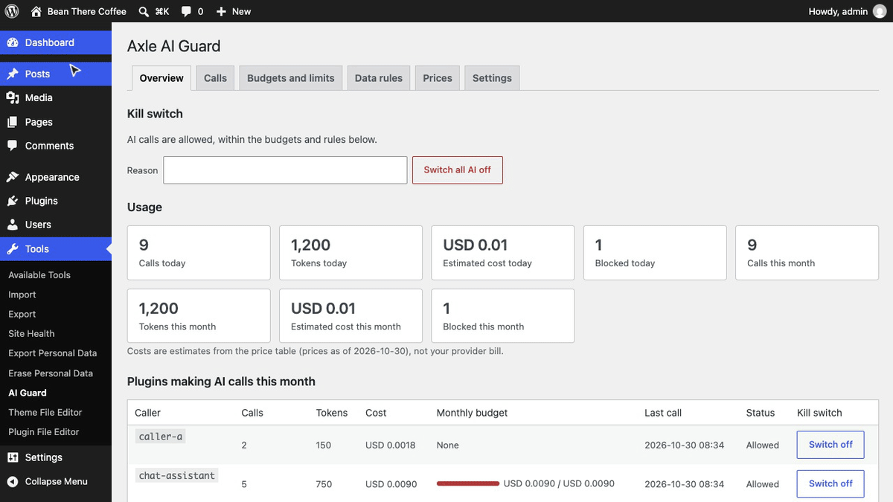
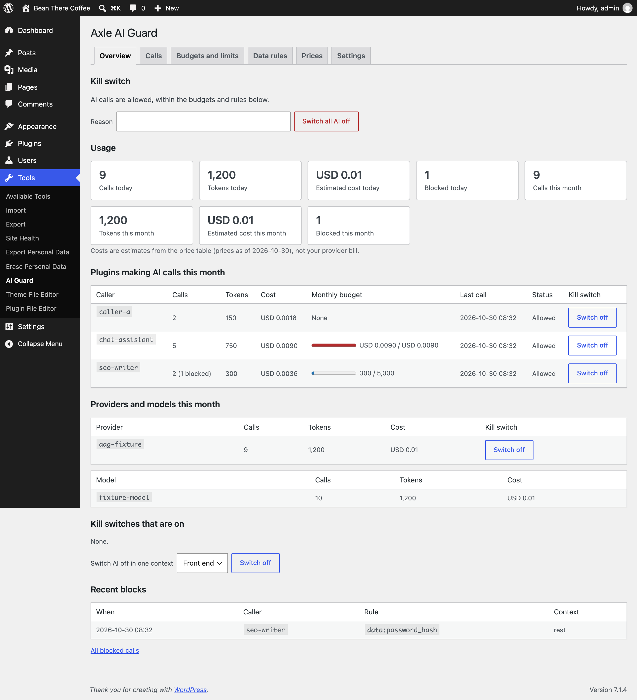
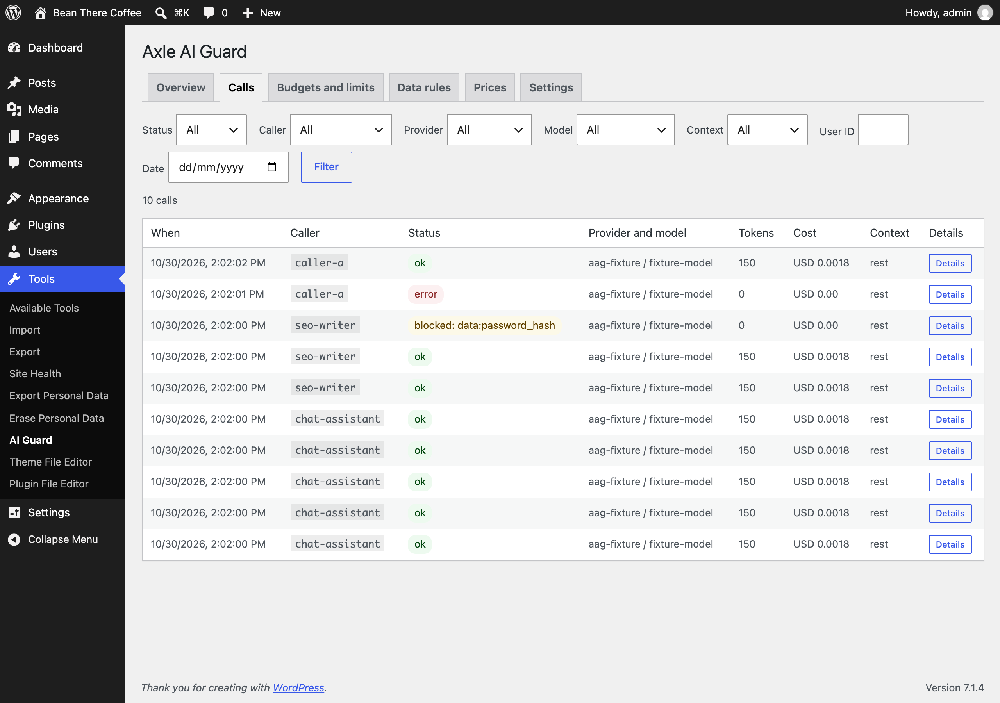
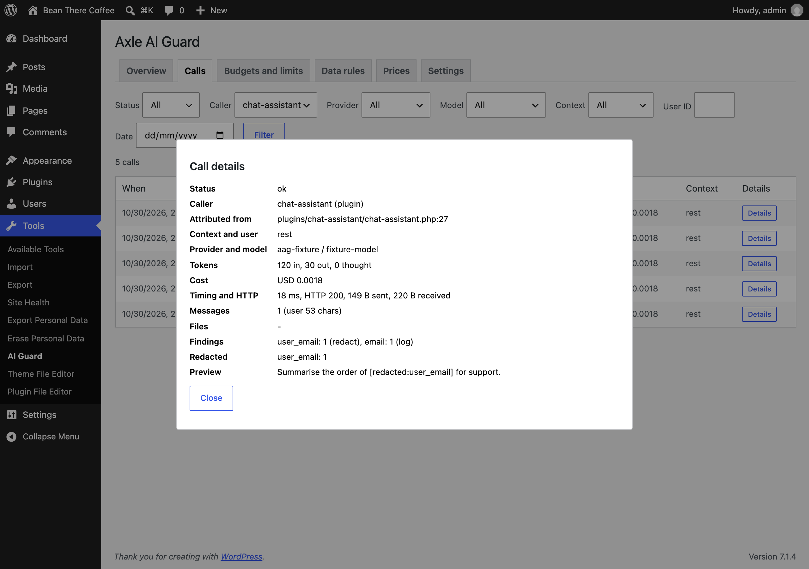
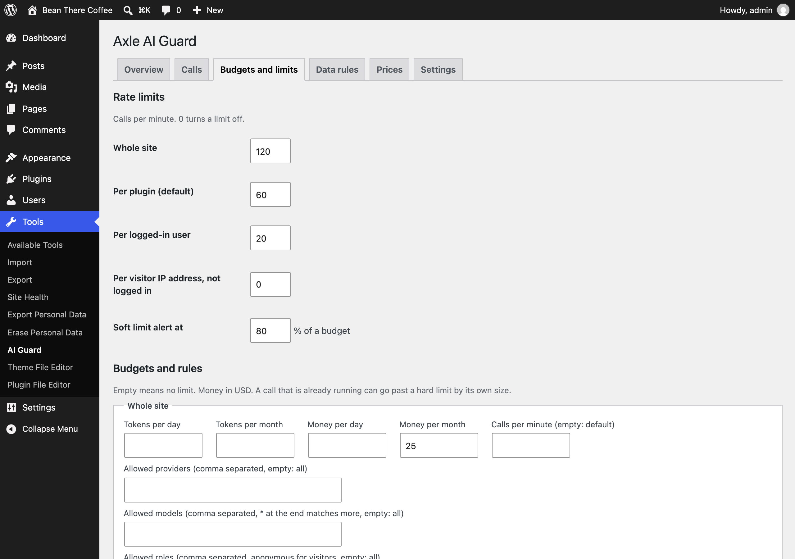
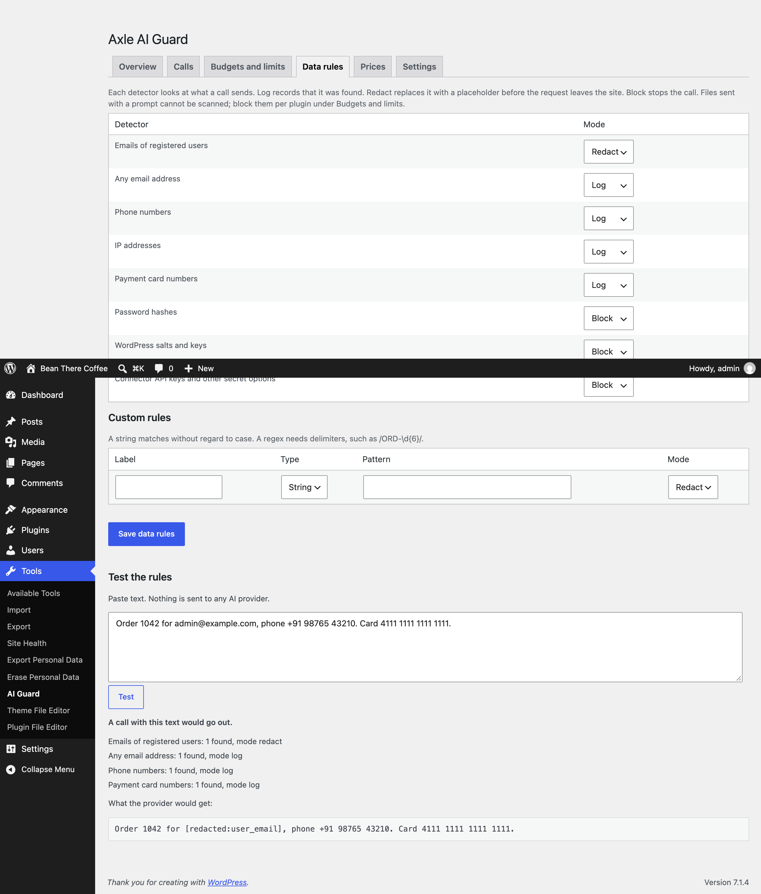
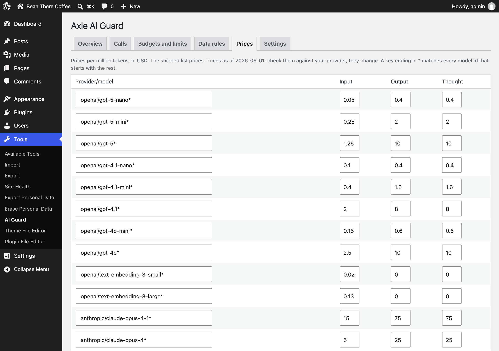

<p align="center"></p>

<h1 align="center">Axle AI Guard</h1>

<p align="center">
  <a href="https://playground.wordpress.net/?blueprint-url=https://raw.githubusercontent.com/aryanjasala/axle-ai-guard/main/blueprint.json"></a>
  <a href="https://github.com/aryanjasala/axle-ai-guard/releases/latest"></a>
  
  
  <a href="LICENSE.md"></a>
  <br>
  <a href="https://github.com/aryanjasala/axle-ai-guard/actions/workflows/phpcs.yml"></a>
  <a href="https://github.com/aryanjasala/axle-ai-guard/actions/workflows/phpstan.yml"></a>
  <a href="https://github.com/aryanjasala/axle-ai-guard/actions/workflows/unit-tests.yml"></a>
  <a href="https://github.com/aryanjasala/axle-ai-guard/actions/workflows/e2e-tests.yml"></a>
  <a href="https://github.com/aryanjasala/axle-ai-guard/actions/workflows/plugin-check.yml"></a>
</p>

<p align="center">See and control every AI call your plugins make: what it cost, what site data it carried, budgets, rate limits, data rules and a kill switch.</p>

<p align="center">
   AI Guard" width="880">
</p>

---

Since WordPress 7.0 any plugin can call an AI provider through the WordPress AI Client, with the key saved under Settings > Connectors. A chatbot on the front end, an SEO tool in a cron job and a helper you forgot about then all spend from the same key, and nothing shows which one sent what. Axle AI Guard sits between those plugins and the provider. It logs every call with its caller, cost and a profile of the data it carried, redacts or blocks personal data before the request leaves the site, and adds money and token budgets, rate limits and kill switches.

> [!NOTE]
> Free and open source under the GPL. No pro version, no upsells, no ads in wp-admin, no tracking. And it stays that way.
>
> Part of Axle by AryanX, a family of plugins for running WordPress sites safely.

## Features

- **Data rules**: detectors for user emails, any email, phone numbers, IP addresses, card numbers (Luhn), password hashes, WordPress salts, connector API keys and your own strings or regexes. Each one off, log, redact or block. Redaction rewrites the request body for OpenAI, Anthropic and Google formats and keeps no map back. A test box runs the rules with no AI call
- **Money and token budgets**: daily and monthly, for the site and per plugin, in the site currency. Alert at 80%, block at 100%. Parallel requests never lose a count
- **Rate limits**: per plugin, per logged-in user, per visitor IP address (so a chatbot cannot become a free AI proxy) and for the site
- **Kill switches**: site, plugin, provider or context (no AI on the front end), from the screen, WP-CLI, an ability or a wp-config.php constant. Network switch on multisite. Optional auto-trip on the monthly budget or an error spike
- **What was sent and what it cost**: caller and the file it was traced to, context, user, provider, model, tokens, estimated cost, timing and HTTP status. A data profile instead of the prompt; previews and a redacted prompt store are opt-in
- **Rules per plugin**: allowed contexts, providers, models and roles, file attachments, and approval for plugins making their first call
- **Alerts** by email and webhook, throttled to one per event and subject an hour
- **Abilities** for agents to read usage and pull the kill switch (none to turn it back on), full **WP-CLI**, Site Health checks, privacy export and erase

## Install

1. Download `axle-ai-guard.zip` from the [latest release](https://github.com/aryanjasala/axle-ai-guard/releases/latest).
2. In WordPress, go to **Plugins > Add New Plugin > Upload Plugin**, choose the zip and activate it.

Or with WP-CLI:

```sh
wp plugin install https://github.com/aryanjasala/axle-ai-guard/releases/latest/download/axle-ai-guard.zip --activate
```

Needs WordPress 7.0+ and PHP 7.4+. To try it first, the **Try in WordPress Playground** badge opens a throwaway WordPress in your browser with the plugin and some demo content.

## Quick look

```sh
wp axle-ai-guard usage --by=plugin
# Total: 214 calls, 312,400 tokens, USD 1.84, 9 blocked.

wp axle-ai-guard budget set global --monthly-cost=25
wp axle-ai-guard limit set plugin:chatbot --per-minute=10
wp axle-ai-guard rules test "Reply to jane@example.com"
wp axle-ai-guard kill --plugin=chatbot --reason="Loop on the contact page"
```

Or open **Tools > AI Guard**.

## Screenshots

<table>
  <tr>
    <td width="50%" valign="top"><br><sub>Overview: usage today and this month, each plugin with its budget and kill switch, providers, models and recent blocks</sub></td>
    <td width="50%" valign="top"><br><sub>Calls: every AI call with caller, status, model, tokens and cost</sub></td>
  </tr>
  <tr>
    <td width="50%" valign="top"><br><sub>Call details: the file the call was traced to, the data profile, what was found and redacted, tokens, cost and timing</sub></td>
    <td width="50%" valign="top"><br><sub>Budgets and limits per plugin: tokens and money, rate limits, contexts, providers, models and roles</sub></td>
  </tr>
  <tr>
    <td width="50%" valign="top"><br><sub>Data rules with the test box: what each detector found and what the provider would get</sub></td>
    <td width="50%" valign="top"><br><sub>Prices per provider and model, editable, with the date they are from</sub></td>
  </tr>
</table>

## Documentation

| Doc | What it covers |
| --- | --- |
| [Reference](docs/REFERENCE.md) | How a call is checked, callers, data rules, budgets and costs, hooks, JS hooks, abilities, REST, WP-CLI, data and limits |
| [Development](docs/DEVELOPMENT.md) | Local setup, commands and tests |
| [Contributing](docs/CONTRIBUTING.md) | Pull requests, required checks and PR titles |
| [Releasing](docs/RELEASING.md) | How merged pull requests become releases |
| [Security](docs/SECURITY.md) | Reporting a vulnerability |
| [readme.txt](readme.txt) | What WordPress.org shows, with the FAQ and changelog |

## Project structure

```
axle-ai-guard.php        plugin header and PSR-4 autoloader
src/
├── Plugin.php           creates the services
├── Guard.php            the AI Client hooks: prevent, before, after, shutdown
├── Transport.php        the HTTP transport decorator: redaction and measurements
├── Rewriters.php        request body formats for redaction
├── Direct.php           optional monitoring of calls that skip the AI Client
├── Caller.php           who made a call, from the backtrace
├── Context.php          context, user and visitor IP
├── Policy.php           budgets, rate limits and rules
├── Detectors.php        data rules
├── Prices.php           the price table and costs
├── KillSwitch.php       kill switches and the toolbar node
├── Alerts.php           email and webhook alerts
├── Calls.php, Usage.php the log and the counters
├── Reports.php          usage and limits for screens, REST, abilities, CLI
├── Abilities.php        abilities for agents
├── Rest/                routes for the screens
├── Admin/               Tools > AI Guard and Network Admin
├── Health/SiteHealth.php Site Health checks
└── Cli/Command.php      wp axle-ai-guard
assets/                  admin.css, admin.js
tests/
├── Unit/                PHPUnit with Brain Monkey
└── e2e/                 Playwright specs, a fake provider and caller plugins, the Docker site
docs/                    reference, development, contributing, releasing
```

## More free plugins

Small plugins that each fill one gap in WordPress, all free with no pro version:

| | Plugin | What it does |
| --- | --- | --- |
|  | [Page Template Usage](https://github.com/aryanjasala/page-template-usage) | See which template every page uses, and fix the pages on a missing template |
|  | [Staging Guard](https://github.com/aryanjasala/staging-guard) | Stops staging copies from emailing real people or getting indexed |
|  | [Category & Tag Trash](https://github.com/aryanjasala/category-tag-trash) | A trash for categories, tags and custom terms, with undo and full restore |
|  | [Axle Read-Only Mode](https://github.com/aryanjasala/axle-read-only-mode) | Read-only mode for WordPress during migrations and deploys |
|  | [Axle Block Restore](https://github.com/aryanjasala/axle-block-restore) | Restore a single block from an old revision, not the whole post |
|  | [Activity Log with Undo](https://github.com/aryanjasala/activity-log-with-undo) | An activity log where every change you can reverse has an Undo button |
|  | [Agent Governance](https://github.com/aryanjasala/agent-governance) | Hold risky AI agent calls for approval, preview what they change, and roll back a session |
|  | [Block Doctor](https://github.com/aryanjasala/block-doctor) | Scan the whole site for invalid and broken blocks and fix them in bulk, with undo |
|  | [Block Theme Ops](https://github.com/aryanjasala/block-theme-ops) | Find Site Editor changes that override your theme files, see the diff, reset them or send them to Git |
|  | [Role Right-Sizer](https://github.com/aryanjasala/role-right-sizer) | Recommends the smallest role each user needs, from what they actually do |
|  | [Update Rehearsal](https://github.com/aryanjasala/update-rehearsal) | Try plugin, theme, core and PHP updates on a disposable copy of your site in WordPress Playground first |
|  | [User Session Manager](https://github.com/aryanjasala/user-session-manager) | See every device signed in, sign out one, and limit sessions per role |

## License

Copyright Aryan Jasala. Licensed under [GPL-2.0-or-later](LICENSE.md).
